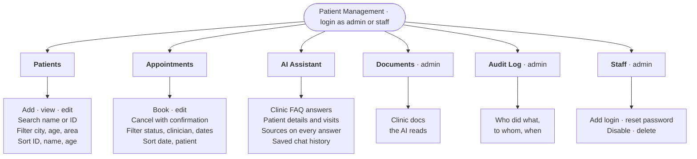

# Patient Management System

A clinic staff portal for managing patients and appointments, with an AI assistant that answers from clinic documents and patient records.

All data is fictional. The app gives no diagnosis or treatment advice.

**Stack:** React (Vite) + Ant Design · Node.js + Express · MongoDB Atlas · Groq (`openai/gpt-oss-20b`) · JWT · Jest

---

## Features



---

## Setup and run

You need **Node.js 18+**, a **MongoDB** connection string ([Atlas free tier](https://cloud.mongodb.com) works) and a **Groq API key** ([get one here](https://console.groq.com/keys)).

**1. Get the code**

```bash
git clone https://github.com/Jag2007/Patient_Management.git
cd Patient_Management
```

**2. Set up and run.** Pick one. Make is only a shortcut: every `make` command runs the npm commands shown next to it, and the app itself doesn't need Make.

| Step | With Make (macOS / Linux) | Without Make (any OS) |
|---|---|---|
| Install packages | `make setup` does all three steps | `cd backend && npm ci` · `cd frontend && npm ci` |
| Create `backend/.env` | | `cd backend && npm run init-env` |
| Create and fill the database | | `cd backend && npm run setup` |
| Run | `make dev` (both apps, Ctrl+C stops both) | `cd backend && npm run dev` and, in a second terminal, `cd frontend && npm run dev` |

Then open **http://localhost:5173** and log in with `admin` / `Admin@123` or `staff` / `Staff@123`.

- **`.env`:** the setup step asks for your MongoDB URI and Groq key, generates `JWT_SECRET`, and writes `backend/.env` from [`.env.example`](.env.example). [`frontend/.env.example`](frontend/.env.example) is only needed when the frontend is hosted separately.
- **`npm ci`** ("clean install") installs the exact versions in `package-lock.json` and fails if they don't match `package.json`. `npm install` may update the lock file. `ci` gives everyone the same dependencies.

**Other Make commands:** `make db` (reload demo data) · `make test` · `make eval` · `make check` (tests + build + security audit) · `make` (list all).

---

## API

- **Table of every endpoint:** [API.md](API.md)
- **Interactive docs (Swagger):** http://localhost:5050/api/docs once the backend is running

---

## Architecture

Diagrams in [`architecture/`](architecture/README.md): [system](architecture/system.md) · [how the AI answers](architecture/ai-flow.md) (with chat history and context handling) · [database](architecture/database.md).

---

## Project structure

```
Patient_Management/
├── architecture/      diagrams
├── backend/
│   ├── routes/        API endpoints
│   ├── services/      business logic (auth, patients, appointments, staff, chat, LLM)
│   ├── tools/         the AI's patient tools
│   ├── models/        database schemas
│   ├── middleware/    login and role checks, error handling
│   ├── docs/          clinic documents the AI answers from
│   ├── setup/         .env helper, migrations, seed data
│   ├── eval/          golden set and benchmark results
│   ├── tests/         Jest tests
│   └── openapi.yaml   API spec for Swagger
├── frontend/src/
│   ├── pages/         Patients, Appointments, AI Assistant, Documents, Audit Log, Staff
│   ├── components/    layout, forms, tables
│   └── api/           backend client, token refresh
├── API.md
├── Makefile
└── .env.example
```

---

## Database

MongoDB, seven collections ([diagram](architecture/database.md)):

- **users**: admin and staff logins
- **patients**: fictional patient records (ID, name, date of birth, contact details)
- **appointments**: bookings linked to a patient, with clinician, reason and status
- **audit_logs**: who viewed or changed which patient or staff account
- **conversations**: saved AI chats
- **refresh_tokens**: login sessions (hashed, auto-deleted when expired)
- **faq_sections**: clinic documents split into searchable paragraphs

Schema and indexes are created by [migrations](backend/setup/migrations/) (`make migrate`). Demo data in [`backend/setup/seed-data/`](backend/setup/seed-data/): 2 users, 150 patients across Hyderabad and Bangalore, 198 appointments (`make seed`).

---

## Tests and evaluation

```bash
make test    # 54 tests, LLM mocked
make eval    # golden set, real model
```

- **Tests:** auth and refresh tokens, patients, appointments, staff, AI tools, chat guardrails. Run on `MONGO_URI_TEST`.
- **Mocked LLM:** `jest.mock` swaps the Groq call for scripted replies (good answer, tool request, broken JSON, fake source, timeout). No network, free, same result every run.
- **Golden set:** 38 questions with reference answers. Last run **37/38 (97.4%)**, 100% correct sources, 100% correct declines, ~2 s per question. Details in [RESULTS.md](backend/eval/RESULTS.md).

---

## Known limitations

| Limitation | Next step |
|---|---|
| Keyword search, no embeddings: misses synonyms ("fees" vs "billing") | Hybrid search with Atlas Vector Search |
| Answers aren't streamed (the judge checks the full answer first) | Stream progress states over SSE |
| Only the last 6 chat messages reach the model | Rolling summary of older turns |
| Every staff member can see every patient | Assign patients to clinicians |
| Access token in localStorage; 30 s account cache is per server | Token in memory only; shared cache (Redis) |
| Diagnosis and injection checks are regex-based | Moderation model before the main call |
| Groq free tier (~8k tokens/min), up to 4 LLM calls per question | Paid tier, cache common FAQ answers |
| No patient notification on cancellation | WhatsApp/SMS after the cancel commits, via a retry queue |
