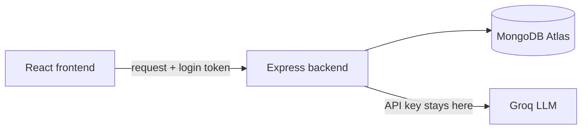
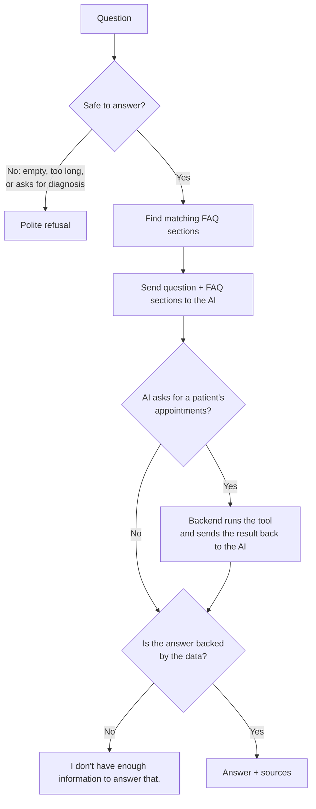

# Patient Management System

A small clinic web app for managing **fictional** patients and appointments, with an AI assistant that answers questions from the clinic's FAQ documents and can look up a patient's appointments through one permission-checked tool.

If the answer is not in that data, the assistant says so instead of guessing.

> All data is synthetic. There is no diagnosis or treatment functionality.

---

## Features

- **Login** for clinic staff with two roles: `admin` and `staff`
- **Patients:** create, view, edit, list, and search by name or patient ID
- **Appointments:** create, view, and cancel (with a confirmation step)
- **AI assistant:** answers from clinic FAQ documents and shows its sources
- **AI tool:** `get_patient_appointments`, which the AI can request and the backend checks before running
- **Audit log:** records who viewed or changed which patient (admin only)

---

## Tech stack

| Layer | Technology |
|---|---|
| Frontend | React (Vite), Ant Design |
| Backend | Node.js, Express |
| Database | MongoDB Atlas, Mongoose |
| AI | Groq API, model `openai/gpt-oss-20b` |
| Auth | JWT, bcrypt |
| Tests | Jest, Supertest |

---

## Project structure

```
Patient_Management/
├── backend/
│   ├── config/          # database connection
│   ├── models/          # Mongoose schemas (data + validation)
│   ├── routes/          # API endpoints (thin: read request, call service, respond)
│   ├── middleware/      # login check, role check, error handler
│   ├── services/        # business logic (patients, appointments, audit, AI chat)
│   ├── tools/           # the AI tool and its permission rules
│   ├── utils/           # small helpers (httpError)
│   ├── docs/            # clinic FAQ documents (fictional)
│   ├── seed/            # script that fills the database with demo data
│   ├── tests/           # Jest + Supertest tests
│   ├── app.js           # Express app setup
│   └── server.js        # starts the server
├── frontend/
│   └── src/
│       ├── api/         # one axios client for all backend calls
│       ├── pages/       # Login, Patients, Appointments, Chat, Audit Log
│       └── components/  # shared UI pieces
├── .env.example
└── README.md
```

---

## Getting started

### Prerequisites
- Node.js 18 or later
- A MongoDB database (MongoDB Atlas free tier works)
- A Groq API key from https://console.groq.com/keys

### Environment variables

Copy `.env.example` to `backend/.env` and fill in the values.

| Variable | Description |
|---|---|
| `PORT` | Backend port (default `5050`) |
| `MONGO_URI` | MongoDB connection string |
| `MONGO_URI_TEST` | A separate database used only by tests |
| `JWT_SECRET` | Random secret used to sign login tokens |
| `GROQ_API_KEY` | Groq API key (used only by the backend) |
| `GROQ_MODEL` | Model name, e.g. `openai/gpt-oss-20b` |
| `CLIENT_ORIGIN` | Frontend URL allowed by CORS (default `http://localhost:5173`) |

### Run the app

```bash
# 1. Backend
cd backend
npm install
npm run seed     # loads demo users, patients, appointments and FAQ documents
npm run dev      # http://localhost:5050

# 2. Frontend (in a new terminal)
cd frontend
npm install
npm run dev      # http://localhost:5173
```

### Demo logins

| Username | Password | Role |
|---|---|---|
| `admin` | `Admin@123` | admin |
| `staff` | `Staff@123` | staff |

---

## Architecture



The frontend never talks to the database or the AI directly. Everything goes through the backend, which is where all permission checks happen.

### How a request works

Every request goes through the same four steps:

1. **Logged in?** `requireLogin` checks the token. No valid token → `401`.
2. **Allowed?** `requireRole` checks the user's role. Wrong role → `403`.
3. **Do the work.** The service validates the input and reads or writes the database.
4. **Respond.** Success returns JSON. Any error is turned into a clean message like `{ "error": "Date of birth cannot be in the future" }`, never a crash or stack trace.

---

## Roles and permissions

| Action | admin | staff |
|---|:-:|:-:|
| Manage patients | ✅ | ✅ |
| Manage appointments | ✅ | ✅ |
| Use the AI assistant and tool | ✅ | ✅ |
| View the audit log | ✅ | ❌ |

Permissions are enforced in backend code. The frontend hides the Audit Log menu for staff only for convenience; calling the API directly still returns `403`.

---

## Database

| Collection | What it stores | Key fields |
|---|---|---|
| `users` | Clinic staff who can log in | `username`, `passwordHash`, `role` |
| `patients` | Fictional patient records | `patientId` (e.g. `P-0001`), `name`, `dateOfBirth`, `phone`, `email`, `address` |
| `appointments` | Appointments linked to a patient | `patient`, `dateTime`, `clinician`, `reason`, `status` |
| `audit_logs` | Who did what to which patient | `username`, `action`, `patientId`, `createdAt` |
| `faq_sections` | Clinic FAQ documents split into paragraphs, searchable by the AI | `source`, `section`, `text` |

**Validation rules**
- Patient: name required, date of birth not in the future, valid email, phone 10–13 digits
- Appointment: all fields required, date must be in the future and within one year
- Status is one of `scheduled`, `completed`, `cancelled`

Schemas live in `backend/models/`. Running `npm run seed` creates the collections, indexes and demo data.

---

## API endpoints

| Method | Endpoint | Access | Description |
|---|---|---|---|
| POST | `/api/auth/login` | public | Log in, returns a token |
| GET | `/api/patients?search=` | admin, staff | List or search patients |
| POST | `/api/patients` | admin, staff | Create a patient |
| GET | `/api/patients/:patientId` | admin, staff | View a patient |
| PUT | `/api/patients/:patientId` | admin, staff | Edit a patient |
| GET | `/api/appointments` | admin, staff | List appointments |
| POST | `/api/appointments` | admin, staff | Create an appointment |
| PATCH | `/api/appointments/:id/cancel` | admin, staff | Cancel an appointment |
| POST | `/api/chat` | admin, staff | Ask the AI assistant |
| GET | `/api/audit-logs` | admin | View the audit log |

---

## AI assistant

**Main idea:** the AI only answers from information the backend gives it, and the backend checks the answer before the user sees it.

### What happens when you ask a question



1. **Check the question.** It must be 1–500 characters. Questions asking for a diagnosis, treatment or medication dosage are refused without calling the AI.
2. **Find relevant FAQ sections.** MongoDB text search returns the top 3 matching paragraphs from the clinic documents.
3. **Ask the AI.** The AI gets the question, the FAQ sections and the tool it may use. It is told to answer only from this information and to reply in a fixed JSON format.
4. **Run the tool if requested.** If the AI asks for a patient's appointments, the backend checks and runs the tool (see below), then asks the AI once more with the result.
5. **Check the answer.** If the AI says it can't answer, or cites a source that wasn't actually provided, the user gets *"I don't have enough information to answer that."*
6. **Show sources.** Source names (e.g. `cancellation-policy.md`) are added by the backend, so the AI cannot invent them.

If Groq is slow, down or rate-limited, the user sees a friendly message instead of an error.

---

## AI tool: `get_patient_appointments`

The AI can **request** this tool, but only the backend decides whether it runs.

| Step | What the backend does |
|---|---|
| 1. Permission | Checks the logged-in user's role is allowed to use the tool |
| 2. Validation | Accepts exactly one argument, `patientId`, in the format `P-0001` |
| 3. Audit | Records who looked up which patient |
| 4. Query | Runs one fixed, read-only database query |
| 5. Limit | Returns only date/time, clinician, reason and status |

The AI never gets direct database access, and it never sees phone numbers, emails or addresses.

---

## Safety

- **Synthetic data only.** No real patient information.
- **No diagnosis or treatment.** These questions are refused.
- **No made-up answers.** The AI answers only from the FAQ or the tool result; otherwise it says it doesn't know.
- **No made-up sources.** Sources are built by the backend.
- **Untrusted input.** User messages and documents are treated as data, not instructions.
- **Access control in code.** Permissions are checked by the backend, never by the AI prompt.
- **No secrets in the repo.** API keys live only in `backend/.env`, which is git-ignored.

---

## Bonus features

**Audit log.** Viewing, creating or editing a patient, creating or cancelling an appointment, and every AI tool call are recorded with the username, action and patient ID. No other patient details are stored. Only admins can view it.

**Safe cancellation.** The UI asks *"Are you sure?"* before cancelling. The backend cancels with a single atomic update that only matches appointments still `scheduled`, so a double click can't cancel twice. The second attempt gets `409 Conflict`.

---

## Testing

```bash
cd backend
npm test
```

Tests use a separate test database and do not call the AI.

- Invalid patient data is rejected
- Appointment in the past is rejected
- Appointment more than a year ahead is rejected
- Cancelling the same appointment twice fails the second time
- Staff get `403` on the audit log
- The AI tool rejects a disallowed role, a bad patient ID and extra arguments
- An off-topic question returns the "not enough information" answer
- A diagnosis question is refused

---

## Known limitations

| Limitation | Next step |
|---|---|
| Keyword search misses synonyms ("fees" vs "billing") | Add embedding-based search |
| No chat history or streaming | Store conversations; stream responses |
| Diagnosis filter is keyword-based | Add a moderation model |
| No per-clinician access to patients | Restrict each clinician to their own patients |
