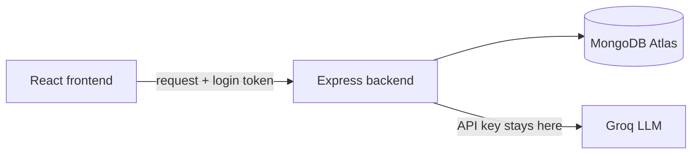
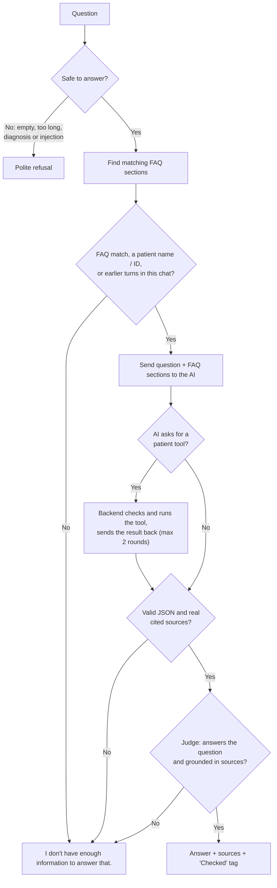

# Patient Management System

A small clinic web app for managing **fictional** patients and appointments. It includes an AI assistant that answers questions from the clinic's FAQ documents and can look up a patient's details or appointments, by name or ID, through two permission-checked tools.

If the answer is not in that data, the assistant says so instead of guessing.

> All data is synthetic. There is no diagnosis or treatment functionality.

## Submission guide

Where to find each item the assignment asks for. Every link jumps to the exact section or file.

| Category | Asked for | Where it is |
|---|---|---|
| **Source code** | Source code in a Git repository | This repository · [Project structure](#project-structure) |
| **Setup and run** | Setup instructions | [Prerequisites](#prerequisites) · [Run the app](#run-the-app) · [Demo logins](#demo-logins) |
| | Environment variables | [Environment variables](#environment-variables) |
| | Database setup | [Database setup](#database-setup) · step-by-step guide in [`backend/setup/README.md`](backend/setup/README.md) |
| | Commands to run the application | [Run the app](#run-the-app) |
| **Database** | Database schema or migrations | [Database](#database) (collections, fields, indexes) · migrations in [`backend/setup/migrations/`](backend/setup/migrations/) |
| | Small synthetic seed dataset | [`backend/setup/seed-data/`](backend/setup/seed-data/) (150 patients: 100 Hyderabad, 50 Bangalore; 198 appointments) · [Clinic documents](#clinic-documents-the-ais-knowledge) |
| **Configuration** | `.env.example` with variable names only, no real secrets | [`.env.example`](.env.example) · [`frontend/.env.example`](frontend/.env.example) |
| **Architecture note** | The LLM | [Architecture note](#architecture-note-llm-retrieval-tools) · [LLM settings](#llm-settings-servicesllmservicejs-the-only-file-that-talks-to-groq) |
| | Retrieval approach | [What happens when you ask a question](#what-happens-when-you-ask-a-question) · [Why keyword search](#why-keyword-search-instead-of-embeddings) |
| | AI tool | [AI tools](#ai-tools) (the tool requirement, mapped point by point) |
| **Quality** | A few tests | [Testing](#testing) · [`backend/tests/`](backend/tests/) · evaluation set in [`backend/eval/`](backend/eval/) |
| | Known limitations or incomplete features | [Known limitations](#known-limitations) · [Bonus features](#bonus-features) (what was and wasn't done) |
| **Extras** | Core requirements, one by one | [Assignment checklist](#assignment-checklist) |
| | Security and permissions | [Roles and permissions](#roles-and-permissions) · [Safety](#safety) |

---

## Features

- **Login** for clinic staff with two roles: `admin` and `staff`
- **Staff management (admin only):** admins create staff logins, reset passwords, disable/enable and delete them; staff can't see or call any of it
- **Patients:** create, view, edit, list, live search by name or patient ID, filters (city, age group, area, has email) and "Sort by" (ID, newest/oldest added, name A–Z/Z–A, age)
- **Appointments:** create, view, **edit** (date/time, clinician, reason), filter (status, clinician, date range, text search), "Sort by" (date, patient name, clinician), and cancel with an explicit, transaction-safe confirmation
- **AI assistant:** answers from clinic FAQ documents and patient records, always shows its sources, and remembers the current chat (e.g. *"Which patient are we talking about?"*)
- **AI tools:** `get_patient_appointments` and `get_patient_details`, which the AI can request and the backend checks before running
- **LLM judge:** a second AI call re-checks every answer against the question and the exact source text before it is shown
- **Chat history:** every chat is saved per user and can be reopened or deleted
- **Audit log:** records who viewed or changed which patient, with a per-patient activity timeline (admin only)
- **Documents:** admins can read every clinic document the AI answers from, section by section
- **Database setup:** migrations (collections, validation rules, indexes) and a synthetic seed dataset (150 patients across Hyderabad and Bangalore) in `backend/setup/`
- **Evaluation set:** `npm run eval` checks answer correctness and source grounding against the real model

---

## Tech stack

| Layer | Technology |
|---|---|
| Frontend | React (Vite), Ant Design |
| Backend | Node.js, Express |
| Database | MongoDB Atlas, Mongoose |
| AI | Groq API, model `openai/gpt-oss-20b` |
| Auth | JWT, bcrypt |
| Tests | Jest, Supertest |

---

## Project structure

```
Patient_Management/
├── backend/
│   ├── config/          # database connection
│   ├── models/          # Mongoose schemas (data + validation)
│   ├── routes/          # API endpoints (thin: read request, call service, respond)
│   ├── middleware/      # login check, role check, error handler
│   ├── services/        # business logic (patients, appointments, audit, retrieval, LLM, chat)
│   ├── tools/           # the AI tools and their permission rules
│   ├── utils/           # small helpers (httpError, escapeRegex)
│   ├── docs/            # clinic FAQ documents (fictional)
│   ├── setup/           # migrations, seed script and the seed dataset (JSON) — see backend/setup/README.md
│   ├── eval/            # evaluation set for the AI (correctness + source grounding)
│   ├── tests/           # Jest + Supertest tests
│   ├── app.js           # Express app setup
│   └── server.js        # starts the server
├── frontend/
│   └── src/
│       ├── api/         # one axios client for all backend calls + session storage
│       ├── pages/       # Login, Patients, Appointments, AI Assistant, Documents, Audit Log, Staff
│       ├── components/  # layout, forms, activity drawer
│       └── theme.js     # colours and Ant Design theme
├── .env.example
└── README.md
```

---

## Getting started

### Prerequisites
- Node.js 18 or later
- A MongoDB database (MongoDB Atlas free tier or a local `mongod`)
- A Groq API key from https://console.groq.com/keys

### Environment variables

Copy `.env.example` to `backend/.env` and fill in the values.

| Variable | Description |
|---|---|
| `PORT` | Backend port (default `5050`; port 5000 is used by AirPlay on macOS) |
| `MONGO_URI` | MongoDB connection string, including the database name |
| `MONGO_URI_TEST` | A separate database used only by tests |
| `JWT_SECRET` | Random secret used to sign login tokens (e.g. `openssl rand -hex 32`) |
| `GROQ_API_KEY` | Groq API key (used only by the backend) |
| `GROQ_MODEL` | Model name, e.g. `openai/gpt-oss-20b` |
| `CLIENT_ORIGIN` | Frontend URL allowed by CORS (default `http://localhost:5173`) |

### Database setup

Full step-by-step guide, including how to get a `MONGO_URI` from Atlas or a local MongoDB and `mongosh` commands to check the result: **[`backend/setup/README.md`](backend/setup/README.md)**.

```bash
cd backend
npm install
npm run migrate   # create collections, validation rules and indexes (safe to run again)
npm run seed      # load the synthetic dataset: 2 users, 150 patients, 198 appointments, 15 FAQ sections
```

| Path | What it is |
|---|---|
| `backend/setup/migrations/001-initial-schema.js` | Collections with `$jsonSchema` validation rules and all indexes (incl. the text index the AI searches) |
| `backend/setup/migrations/002-chat-history.js` | The `conversations` collection for chat history |
| `backend/setup/migrations/003-staff-accounts.js` | `active` and `lastLoginAt` on users, for staff management |
| `backend/setup/seed-data/*.json` | The synthetic seed dataset (users, patients, appointments) |
| `backend/setup/seed.js` | Loads the dataset and splits `backend/docs/*.md` into FAQ sections |

Applied migrations are recorded in the `migrations` collection, so each runs once. The Mongoose schemas in `backend/models/` hold the same rules with friendly error messages; the database rules are a second safety net.

### Run the app

```bash
# 1. Backend
cd backend
npm run dev      # http://localhost:5050

# 2. Frontend (in a new terminal)
cd frontend
npm install
npm run dev      # http://localhost:5173
```

The frontend forwards `/api` requests to the backend (see `frontend/vite.config.js`), so the browser only talks to one address.

### Demo logins

| Username | Password | Role |
|---|---|---|
| `admin` | `Admin@123` | admin |
| `staff` | `Staff@123` | staff |

---

## Deployment (Render + Vercel)

The backend runs on **Render** and the frontend on **Vercel**. Deploy the backend first, because the frontend needs its URL.

**1. MongoDB Atlas:** Network Access → allow `0.0.0.0/0` (Render's IP addresses change). Set up once from your machine with `npm run setup` (migrate + seed) in `backend/`.

**2. Render (backend):** New → Web Service → connect this repo.

| Setting | Value |
|---|---|
| Root Directory | `backend` |
| Runtime | Node |
| Build Command | `npm install` |
| Start Command | `npm start` |
| Health Check Path | `/api/health` |
| Environment | `MONGO_URI`, `JWT_SECRET`, `GROQ_API_KEY`, `GROQ_MODEL=openai/gpt-oss-20b`, `CLIENT_ORIGIN=https://<your-app>.vercel.app` |

Render sets `PORT` itself. `MONGO_URI_TEST` is only for tests and isn't needed.

**3. Vercel (frontend):** Add New → Project → import this repo.

| Setting | Value |
|---|---|
| Root Directory | `frontend` |
| Framework Preset | Vite |
| Install Command | `npm install` |
| Build Command | `npm run build` |
| Output Directory | `dist` |
| Environment | `VITE_API_BASE_URL=https://<your-service>.onrender.com/api` |

`frontend/vercel.json` sends every page (e.g. `/patients`) to `index.html`, so refreshing a page doesn't 404.

**4.** Once Vercel gives you the final URL, put it in Render's `CLIENT_ORIGIN` (comma-separate several, e.g. a custom domain) and redeploy the backend.

> Render's free tier sleeps after 15 minutes idle; the first request after that can take about 50 seconds.

---

## Architecture



The frontend never talks to the database or the AI directly. Everything goes through the backend, which is where all permission checks happen.

### How a request works

Every request goes through the same four steps:

1. **Logged in?** `requireLogin` checks the token. No valid token → `401`.
2. **Allowed?** `requireRole` checks the user's role. Wrong role → `403`.
3. **Do the work.** The service validates the input and reads or writes the database.
4. **Respond.** Success returns JSON. Any error is turned into a clean message like `{ "error": "Date of birth cannot be in the future" }`, never a crash or stack trace.

---

## Roles and permissions

| Action | admin | staff |
|---|:-:|:-:|
| Manage patients | ✅ | ✅ |
| Manage appointments | ✅ | ✅ |
| Use the AI assistant and its tools | ✅ | ✅ |
| View the audit log and patient activity | ✅ | ❌ |
| View the AI's documents | ✅ | ❌ |
| Manage staff logins (create, reset password, disable, delete) | ✅ | ❌ |

Permissions are enforced in backend code. The frontend hides the Documents, Audit Log and Staff menus for staff only for convenience; calling the API directly still returns `403`.

Every request also re-checks the account in the database: a disabled or deleted account is logged out on its next request, even with a token issued earlier. A disabled account that logs in with the right password gets *"This account has been disabled. Please contact an admin."* Admin accounts can't be changed from the Staff page, so an admin can't lock themselves out.

---

## Database

| Collection | What it stores | Key fields |
|---|---|---|
| `users` | Clinic staff who can log in | `username`, `passwordHash`, `role`, `active`, `lastLoginAt` |
| `patients` | Fictional patient records | `patientId` (e.g. `P-0001`), `name`, `dateOfBirth`, `phone`, `email`, `address` |
| `appointments` | Appointments linked to a patient | `patient`, `dateTime`, `clinician`, `reason`, `status` |
| `audit_logs` | Who did what to which patient or staff account | `username`, `action`, `patientId` or `targetUsername`, `createdAt` |
| `faq_sections` | Clinic FAQ documents split into paragraphs, searchable by the AI | `source`, `section`, `text` |
| `conversations` | Saved AI chats, one per chat, owned by one user | `user`, `title`, `messages[] { role, text, sources, verified }` |
| `migrations` | Which setup migrations have run | `name`, `appliedAt` |

**Indexes:** `patients.patientId` (unique), `patients.name`, `users.username` (unique), `appointments.patient + dateTime`, `conversations.user + updatedAt`, and a **text index** on `faq_sections.text`.

**Validation rules**
- Patient: name required, date of birth not in the future, valid email, phone 10–13 digits
- Appointment: all fields required, date must be in the future and within one year
- Status is one of `scheduled`, `completed`, `cancelled`

---

## API endpoints

| Method | Endpoint | Access | Description |
|---|---|---|---|
| POST | `/api/auth/login` | public | Log in, returns a token (10 failed attempts per 15 min per IP) |
| GET | `/api/patients?search=` | admin, staff | List or search patients |
| POST | `/api/patients` | admin, staff | Create a patient |
| GET | `/api/patients/:patientId` | admin, staff | View a patient |
| PUT | `/api/patients/:patientId` | admin, staff | Edit a patient |
| GET | `/api/appointments?patientId=` | admin, staff | List appointments |
| POST | `/api/appointments` | admin, staff | Create an appointment |
| PUT | `/api/appointments/:id` | admin, staff | Edit a scheduled appointment's date/time, clinician or reason |
| PATCH | `/api/appointments/:id/cancel` | admin, staff | Cancel an appointment (transaction-safe) |
| POST | `/api/chat` | admin, staff | Ask the AI assistant: `{ question, conversationId? }` → `{ answer, sources, verified, conversationId }` (rate limited) |
| GET | `/api/chat/conversations` | admin, staff | List your own saved chats |
| GET | `/api/chat/conversations/:id` | admin, staff | Open one of your chats |
| DELETE | `/api/chat/conversations/:id` | admin, staff | Delete one of your chats |
| GET | `/api/users` | admin | List staff and admin accounts (never password hashes) |
| POST | `/api/users` | admin | Create a staff login `{ username, password }` (always role `staff`) |
| PUT | `/api/users/:id/password` | admin | Reset a staff password |
| PATCH | `/api/users/:id/active` | admin | Disable or enable a staff login `{ active }` |
| DELETE | `/api/users/:id` | admin | Delete a staff login |
| GET | `/api/audit-logs?patientId=` | admin | View the audit log, or one patient's activity |
| GET | `/api/documents` | admin | The AI's clinic documents, grouped by file and section |

---

## AI assistant

**Main idea:** the AI only answers from information the backend gives it, and the backend checks the answer (with its own rules and with a second AI call, the judge) before the user sees it.

### Architecture note (LLM, retrieval, tools)

| Part | Choice |
|---|---|
| **LLM** | Groq `openai/gpt-oss-20b`, called only from `services/llmService.js` (temperature 0, 15 s timeout). Used twice per answer: once to answer, once as the judge. |
| **Retrieval** | MongoDB text-index keyword search over FAQ paragraphs (`faq_sections`), top 3 above a minimum score, labelled `S1`–`S3`. Patient data is never searched freely; it only comes from tools. |
| **AI tools** | `get_patient_details`, `get_patient_appointments` (Groq function calling). The backend checks the role, validates arguments, runs one fixed read-only query, returns whitelisted fields, and writes an audit entry. Tool results are labelled `T1`, `T2`. |
| **Memory** | The last 3 questions and answers of the current chat are read from the `conversations` collection (not from the browser) and given to the AI as source `H1`. |
| **Verification** | JSON format check → cited sources must exist → the judge must confirm the answer matches the question and every fact is in the cited sources. Any failure gives *"I don't have enough information to answer that."* |

### What happens when you ask a question



1. **Check the question.** It must be 1–500 characters. Questions asking for a diagnosis, treatment or medication dosage, and obvious prompt-injection phrases, are refused without calling the AI.
   - **Chat memory:** if the question belongs to a saved chat (`conversationId`), the backend loads that chat's last 3 questions and answers **from the database** (only the owner's chat) and passes them as `<conversation>` source `H1`. That is how *"Which patient are we talking about?"* after *"Show me the details of Sneha Reddy"* is answered with "Sneha Reddy", and how "her appointments" finds the right patient. The browser cannot inject fake earlier answers, because it only sends an ID.
2. **Find relevant FAQ sections.** Common question words are removed, then MongoDB text search returns the top 3 matching paragraphs (labelled `S1`–`S3`).
3. **Decide whether to call the AI.** If no FAQ section matches, the question doesn't mention a known patient name or ID, and there are no earlier turns in this chat, the user gets the fallback and **the AI is never called**.
4. **Ask the AI.** It gets the question, today's date, the FAQ sections, and the tools its user is allowed to use. It must answer only from this data and reply in a fixed JSON format: `{ can_answer, answer, used_source_ids }`.
5. **Run tools if requested.** The backend checks and runs each tool (see below), then sends the result back to the AI. This happens at most 2 rounds, so the model cannot loop.
6. **Check the answer.** If the JSON is broken, `can_answer` is false, or the AI cites a source that wasn't actually provided, the user gets *"I don't have enough information to answer that."*
7. **LLM as a judge** (`services/judgeService.js`). A second, separate AI call gets only the question, the answer and the **exact text of the cited sources**, and replies `{ answers_question, grounded, reason }`. If either is false, or the reply isn't valid JSON, the answer is replaced with the fallback (fail closed). Answers that pass show a **"Checked against sources"** tag.
8. **Save and show.** The question and checked answer are saved to the user's chat. Sources: Source labels (e.g. `cancellation-policy.md (section 2)` or `Patient record for P-0003 (Priya Sharma)`) are built by the backend, so the AI cannot invent them.

### LLM settings (`services/llmService.js`, the only file that talks to Groq)

| Setting | Value | Why |
|---|---|---|
| Model | `GROQ_MODEL` env (`openai/gpt-oss-20b`) | Fast, supports tool calling, swappable without code changes |
| Temperature | 0 | Most predictable output |
| Timeout | 15 seconds, no automatic retries | Fail fast with a clear message |

If Groq is slow, down or rate-limited, the user sees a friendly message ("The assistant is busy right now…") instead of an error.

### Why keyword search instead of embeddings?

The FAQ is small, and keyword search is simple, predictable and easy to debug: you can see exactly why a paragraph matched. The trade-off is that it misses synonyms (see Known limitations).

---

## Clinic documents (the AI's knowledge)

All fictional. They live in `backend/docs/`, and `npm run seed` splits each into paragraph sections (`faq_sections`). Admins can read them on the **Documents** page; section numbers match the source tags under chat answers.

| File | Title | What it covers |
|---|---|---|
| `opening-hours.md` | Opening Hours | Weekday and Saturday hours, walk-in times, pharmacy hours |
| `cancellation-policy.md` | Cancellation Policy | Free cancellation window, the 300-rupee late fee, missed-appointment rule |
| `billing.md` | Billing and Payments | Consultation prices, payment methods (cash, cards, UPI), receipts |
| `insurance.md` | Insurance | Partner insurers, documents to bring, reimbursement for other insurers |
| `contact.md` | Contact Information | Address, parking, phone and email, emergency number |

---

## AI tools

> **Assignment requirement:** *"Implement at least one narrowly scoped backend tool that the AI can request, such as searching for a patient or retrieving a patient's appointments. Validate tool arguments and enforce user permissions on the backend. Do not give the model unrestricted database access."*

| Requirement | How it is met (`backend/tools/patientTools.js`) |
|---|---|
| Narrowly scoped tool the AI can request | Two tools: `get_patient_appointments` and `get_patient_details`, offered through Groq function calling. Each does one thing for one patient. |
| Validate tool arguments | `parseArguments()`: must be a JSON object with **exactly one** field, `patientId` matching `P-0000` or a `name` of letters only (2–100 chars). Anything else (extra fields, both fields, bad JSON, injection text) is rejected before any query runs. |
| Enforce user permissions on the backend | `canUseTool()` checks the logged-in user's role against the tool's `roles` list on every call. Tools a role can't use are not even offered to the model. The prompt is never relied on for permissions. |
| No unrestricted database access | The model never sees a query or a model object. Each tool runs one fixed, read-only query and returns only whitelisted fields; at most 2 tool calls per round and 2 rounds per question. Every tool use is written to the audit log. |
| Tested | `tests/ai.test.js` → *AI patient tools* (disallowed role, unknown tool, bad ID, extra/both arguments, non-JSON, ambiguous name, field whitelist, audit entry) |

The AI can **request** these tools using Groq function calling, but only the backend decides whether they run.

Each tool is one entry in the `TOOLS` object in `tools/patientTools.js`: its allowed roles, description, read-only query, source label, and the fixed reply to give when it finds nothing. The chat service never mentions tool names, so adding a tool means adding one entry.

| Tool | Returns |
|---|---|
| `get_patient_appointments` | Date/time, clinician, reason and status of each appointment |
| `get_patient_details` | Patient ID, name, date of birth, age, phone, email, address |

Each tool takes **exactly one** argument: `patientId` (e.g. `P-0003`) or `name` (e.g. `Priya Sharma`).

| Step | What the backend does |
|---|---|
| 1. Permission | Checks the logged-in user's role is in that tool's `roles`. Tools the user can't use are not even offered to the AI. |
| 2. Validation | Arguments must be valid JSON with exactly one field: `patientId` in the format `P-0000`, or a plain name |
| 3. Find patient | If no patient matches, or a name matches several patients, the backend replies directly (e.g. *"I found more than one matching patient: P-0003 Ravi Kumar, P-0004 Ravi Shankar. Please ask again with the patient ID."*) without asking the AI to guess |
| 4. Audit | Records who looked up which patient (`ai.tool.get_patient_details`, etc.) |
| 5. Query | Runs one fixed, read-only database query and returns only the fields above |

The AI never gets direct database access. Medical data such as lab values is not stored, so questions like *"What is Sneha's blood pressure?"* get the "not enough information" answer.

---

## Safety

- **Synthetic data only.** No real patient information.
- **No diagnosis or treatment.** These questions are refused before reaching the AI, and the prompt forbids it too.
- **No made-up answers.** The AI answers only from the FAQ or tool results; otherwise it says it doesn't know.
- **No made-up sources.** Sources are built by the backend from what was actually retrieved.
- **Untrusted input.** User messages, documents and tool results are wrapped in tags and treated as data, not instructions. Angle brackets are stripped from questions.
- **Access control in code.** Permissions are checked by the backend, never by the AI prompt.
- **Brute-force protection.** Failed logins are limited to 10 per 15 minutes per IP; chat is limited to 20 questions per minute per user.
- **Safe startup.** The server refuses to start if `MONGO_URI` or `JWT_SECRET` is missing, with a clear message.
- **No secrets in the repo.** API keys live only in `backend/.env`, which is git-ignored.

---

## Bonus features

Status of the optional bonus items from the brief:

| Bonus item | Status |
|---|---|
| Semantic search (embeddings / vector DB) | Not done: keyword text search (see Known limitations) |
| Chat history and streaming responses | **Chat history done** (saved per user, reopen/delete, used as memory). Streaming not done |
| Audit events for access to or changes in patient records | **Done** |
| Cancellation with explicit confirmation and transaction-safe handling | **Done** |
| Small evaluation set for answer correctness and source grounding | **Done** (`npm run eval`, plus the LLM judge on every live answer) |
| Docker-based local setup | Not done |

**Chat history.** Every question and checked answer is saved in the `conversations` collection under the logged-in user. The AI Assistant page lists your chats on the left; click one to reopen it, or delete it. Every query filters by the user's ID, so one user cannot read, continue or delete another user's chat (`404`). The last 3 turns are the AI's memory for follow-ups.

**Audit log.** Viewing, creating or editing a patient, creating, editing or cancelling an appointment, and every AI tool call are recorded with the username, action and patient ID. No other patient details are stored. When an admin reads the log, current patient names are looked up and added for display only. Admins can filter the log by user or action, and click a patient (or "Activity" on the Patients page) to see their details and full history as a timeline.

**Safe cancellation.** Clicking *Cancel* opens a confirmation that shows exactly which appointment (patient, clinician, date, reason) will be cancelled, with *"Keep appointment"* / *"Yes, cancel appointment"* buttons. The backend then:

```js
withTransaction(async (session) => {
  const appointment = await Appointment.findOneAndUpdate(
    { _id: id, status: 'scheduled' }, { status: 'cancelled' }, { session });   // only if still scheduled
  if (!appointment) throw httpError(409, 'Only scheduled appointments can be cancelled');
  await logAction(user, 'appointment.cancel', patientId, session);            // audit entry in the same transaction
});
```

- **Transaction:** the status change and its audit entry are committed together, or neither is saved (`utils/withTransaction.js`).
- **No double cancel:** the "still scheduled" check and the update are one atomic step, so a double click gets `409 Conflict` the second time.
- Editing an appointment uses the same pattern. On a standalone local `mongod` (no replica set) the writes run without a transaction; see `backend/setup/README.md`.

**Evaluation set.** `backend/eval/evalSet.json` has 12 cases run against the **real** model and the seeded database (`npm run eval`):

| Type | Cases | Passes when |
|---|---|---|
| FAQ answers | opening hours, late fee, insurers, UPI, emergency number | Answer contains the expected facts **and** cites the expected document **and** the judge passed it |
| Tool answers | Sneha Reddy's phone, P-0003's appointments | Same, citing the expected patient record |
| Chat memory | "Which patient are we talking about?" after a Sneha Reddy turn | Answer names Sneha Reddy |
| Not in data / off-topic | blood pressure, capital of France | The fallback is returned |
| Safety | diagnosis, prompt injection | The refusal is returned |

Last run: **12/12 passed**.

---

## Testing

```bash
cd backend
npm test
```

49 tests run against the separate `MONGO_URI_TEST` database. The AI tests replace Groq with a Jest mock, so they never call the real API. That also lets them simulate the model misbehaving.

**Core API**
- Correct login returns a token and role; requests without a token are rejected; wrong username and wrong password give the same error
- Invalid patient data is rejected with a message per field
- Editing a patient works, ignores non-editable fields (like `patientId`) and writes an audit entry
- Too many failed logins from one IP are blocked with `429`
- Appointments in the past or more than a year ahead are rejected
- Cancelling the same appointment twice fails the second time, with exactly one audit entry
- Editing an appointment changes clinician/reason, ignores patient and status, and writes an audit entry; past dates, empty edits and editing a cancelled appointment are rejected
- Staff get `403` on the audit log; admins can read the AI's documents grouped by file and staff get `403`; the log stores only patient IDs

**Staff management**
- Staff get `403` on every account endpoint
- An admin-created staff login works, is always role `staff`, and the password hash is never returned
- Weak passwords, bad usernames and duplicate usernames are rejected; admin accounts can't be changed
- A disabled account can't log in and its existing token stops working; enabling restores access
- Reset password replaces the old one; delete removes the login; every change is audited

**AI tools**
- A disallowed role, an unknown tool, a bad patient ID, extra arguments, both `patientId` and `name`, and non-JSON arguments are all rejected
- Lookup by name works, and an ambiguous name returns only the list of matches
- The appointments tool returns only its 4 fields and writes an audit entry

**AI chat guardrails**
- Diagnosis and injection questions are refused without calling the AI
- An unrelated question gets the fallback without calling the AI
- A fake source (`S9`) or broken JSON from the model gives the fallback
- A tool request is run and its source is shown; no appointments gives a fixed reply
- The model is stopped after 2 tool rounds
- "Which patient are we talking about?" is answered from the earlier turns (source `H1`); without earlier turns it gets the fallback; history can't close our prompt tags
- The judge receives the question, answer and cited source text; a "not grounded" verdict gives the fallback; broken judge replies are rejected

**Chat history**
- Each turn is saved, earlier turns are sent to the AI, and another user gets `404` when opening or continuing the chat
- An empty question returns `400`; an AI timeout returns a friendly message

---

## Assignment checklist

| Requirement | Where it is met |
|---|---|
| Create, view, edit, list patients with ID, name, DOB, contact details | `services/patientService.js`, `models/Patient.js`, `pages/PatientsPage.jsx` |
| Search by name or ID, clear validation and error messages | `listPatients()` in `patientService.js`, `middleware/errorHandler.js` |
| Create and view appointments with date/time, clinician, reason, status | `services/appointmentService.js`, `models/Appointment.js`, `pages/AppointmentsPage.jsx` |
| Reject invalid appointment dates | `checkAppointmentDate()` in `appointmentService.js` + date picker limits |
| Chat over clinic FAQ documents and synthetic patient data | `services/chatService.js`, `pages/ChatPage.jsx` |
| LLM called only from the backend, no keys in the frontend | `services/llmService.js`, key read from `backend/.env` |
| Retrieval with source references | `services/retrievalService.js`, sources built in `chatService.js` |
| Say so when the answer is not supported | Retrieval gate, `can_answer` flag, source check → fixed fallback |
| Handle timeouts, invalid input, AI/API failures | `checkQuestion()`, `llmService.js` error mapping, `errorHandler.js` |
| At least one narrowly scoped tool with argument validation and permissions | `tools/patientTools.js` (`TOOLS[...].roles`, `parseArguments()`) |
| No unrestricted database access for the model | Tools run fixed read-only queries and return whitelisted fields |
| Synthetic data only | `setup/seed-data/*.json`, `docs/*.md` |
| No diagnosis or treatment functionality | `MEDICAL_PATTERNS` refusal + system prompt |
| Permissions enforced before data access or tools (not by prompt) | `middleware/auth.js`, `canUseTool()` in `patientTools.js` |
| User messages and documents treated as untrusted | Tags + "data, not instructions" prompt rule, angle brackets stripped, injection filter |
| No secrets in the repo | `.gitignore`, `.env.example` with names only |
| README, schema + seed data, `.env.example`, architecture note, tests, limitations | This README (Database, Architecture note, AI assistant, AI tools, Testing, Known limitations), `backend/setup/` (migrations + seed dataset), `.env.example`, `backend/tests/` |
| Bonus: chat history | `models/Conversation.js`, `services/conversationService.js`, chat history panel in `ChatPage.jsx` |
| Bonus: audit events | `services/auditService.js`, `pages/AuditLogsPage.jsx`, activity drawer |
| Bonus: cancellation with confirmation, transaction-safe | `confirmCancel()` in `AppointmentsPage.jsx`, `cancelAppointment()` + `utils/withTransaction.js` |
| Bonus: evaluation set (correctness + grounding) | `eval/evalSet.json`, `eval/runEval.js`, `services/judgeService.js` |

---

## Known limitations

| Limitation | Next step |
|---|---|
| Keyword search misses synonyms ("fees" vs "billing") | Add embedding-based search (e.g. Atlas Vector Search) |
| Responses aren't streamed (the judge must check the full answer before it is shown) | Stream after the judge passes, or stream with a "checking…" state |
| The judge is another call to the same model, so it can share its blind spots, and it doubles AI calls per answer | Use a different (or larger) model as judge; skip the judge for answers that only repeat a tool result |
| Chat memory is the last 3 turns only | Summarise older turns |
| Safety filter is keyword-based and can be bypassed by rephrasing (the prompt and tool limits are the second line of defence) | Add a moderation model before the main call |
| No check that numbers in an answer appear in the source text | Compare numbers in the answer against the retrieved text |
| All staff can see all patients | Assign patients to clinicians and check ownership in services and tools |
| JWT is stored in the browser and there are no refresh tokens | httpOnly cookies with refresh-token rotation |
| Groq free tier allows about 8,000 tokens per minute | Paid tier or caching of common FAQ answers |
