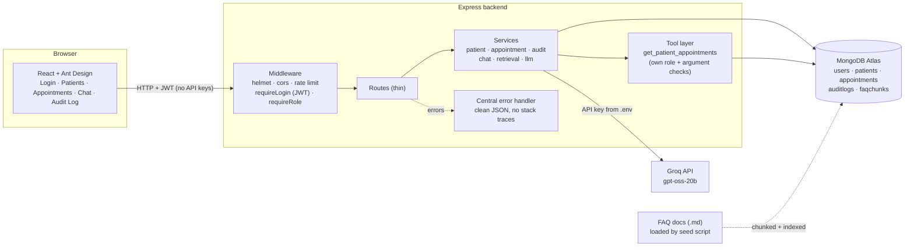
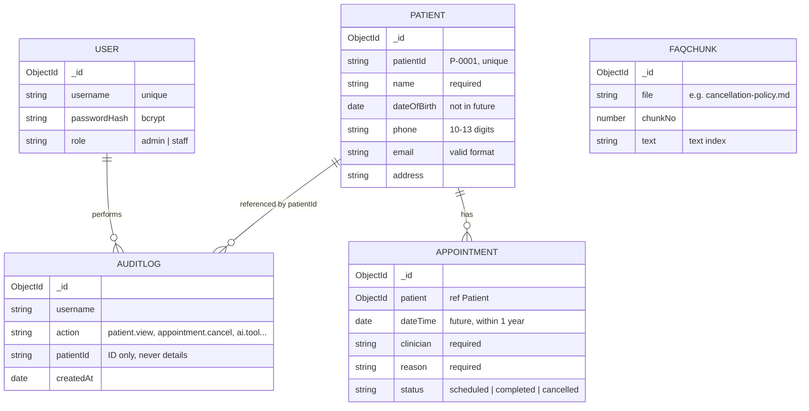
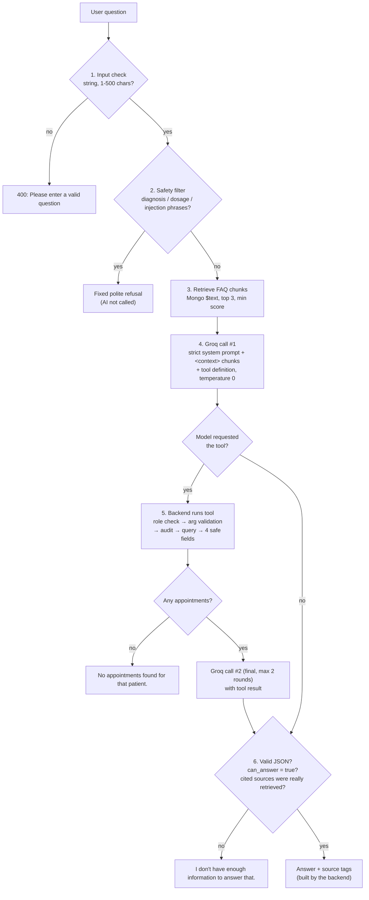

# Patient Management System (AI-powered)

A small clinic web app where staff manage **fictional** patients and appointments, plus an AI assistant that answers questions **only** from clinic FAQ documents and a single, permission-checked appointments tool. When the answer isn't in that data, it says so instead of guessing.

> All patient data in this project is synthetic. There is no diagnosis or treatment functionality.

---

## Table of contents

1. [Users vs patients](#1-users-vs-patients)
2. [Tech stack](#2-tech-stack)
3. [System architecture](#3-system-architecture)
4. [Request lifecycle](#4-request-lifecycle)
5. [Roles and permissions](#5-roles-and-permissions)
6. [Data model](#6-data-model)
7. [API endpoints](#7-api-endpoints)
8. [AI assistant](#8-ai-assistant)
9. [AI tool: `get_patient_appointments`](#9-ai-tool-get_patient_appointments)
10. [Guardrails (hallucination and prompt injection)](#10-guardrails)
11. [Audit log and safe cancellation](#11-audit-log-and-safe-cancellation)
12. [Folder structure](#12-folder-structure)
13. [Setup and running](#13-setup-and-running)
14. [Testing](#14-testing)
15. [Design decisions and trade-offs](#15-design-decisions-and-trade-offs)
16. [Known limitations](#16-known-limitations)

---

## 1. Users vs patients

| | **Users** | **Patients** |
|---|---|---|
| Who | Clinic employees (admin, staff) | People the clinic treats (fictional) |
| Log in? | Yes: username + password, JWT | **Never** |
| Stored as | `users` collection with a role | `patients` collection, a record only |
| Example | Staff member "staff" books an appointment | Patient `P-0003` is the one being booked |

Users act on patients. Patients are data.

---

## 2. Tech stack

| Layer | Choice | Why |
|---|---|---|
| Frontend | React (Vite) + Ant Design | Ready-made tables, forms, date pickers, so time goes into logic |
| Backend | Node.js + Express | Small, explicit routing and middleware |
| Database | MongoDB Atlas + Mongoose | Schema validation in models; built-in text index for retrieval |
| LLM | Groq `openai/gpt-oss-20b` via `groq-sdk` | Fast, supports function calling, called **only from the backend** |
| Auth | JWT + bcrypt | Stateless login, hashed passwords |
| Tests | Jest + Supertest | Hit real Express routes against a separate test database |

---

## 3. System architecture



**Where security lives:** in the backend middleware (`requireLogin`, `requireRole`) and again inside the tool. The frontend only hides menu items for convenience; every rule is enforced on the server.

**Layering rule:** routes stay thin (read the request, call a service, send the response), services hold the logic, and models define and validate data.

---

## 4. Request lifecycle

Every API call follows the same path:

```
Request → helmet/cors/rate-limit → requireLogin (verify JWT) → requireRole (check role)
        → route → service (business logic + validation) → audit entry → JSON response
                                   ↓ on any error
                          central error handler → { error: "friendly message" }
```

Example: `PATCH /api/appointments/:id/cancel` by staff → JWT valid → role allowed → atomic cancel → audit `appointment.cancel` → `200 { appointment }`. A second click → `409 "Appointment is not scheduled"`.

---

## 5. Roles and permissions

| Feature | admin | staff |
|---|:-:|:-:|
| Patients: create, view, edit, list, search | ✅ | ✅ |
| Appointments: create, view, cancel | ✅ | ✅ |
| AI chat (FAQ) | ✅ | ✅ |
| AI tool `get_patient_appointments` | ✅ | ✅ |
| Audit log | ✅ | ❌ `403` |

- Route permissions: `requireRole('admin')` on `/api/audit`, for example.
- Tool permissions: a separate allow-list (`TOOL_PERMISSIONS`) checked **inside** the tool before any query. Even if the model is tricked into asking, the backend refuses.
- **A prompt is never used for access control.**

---

## 6. Data model



**Indexes:** `patients.patientId` (unique), `patients.name` (for search), `users.username` (unique), `appointments.patient`, `faqchunks.text` (MongoDB **text index** used for retrieval).

The Mongoose schemas in `backend/models/` are the schema definition; `npm run seed` creates the collections and indexes.

---

## 7. API endpoints

| Method | Path | Role | Purpose |
|---|---|---|---|
| POST | `/api/auth/login` | public | Returns JWT + user info |
| GET | `/api/patients?search=` | admin, staff | List / search by name or ID |
| POST | `/api/patients` | admin, staff | Create (ID auto-generated) |
| GET | `/api/patients/:patientId` | admin, staff | View one |
| PUT | `/api/patients/:patientId` | admin, staff | Edit (only allowed fields copied) |
| GET | `/api/appointments?patientId=` | admin, staff | List, optionally per patient |
| POST | `/api/appointments` | admin, staff | Create (date validated) |
| PATCH | `/api/appointments/:id/cancel` | admin, staff | Atomic cancel |
| POST | `/api/chat` | admin, staff | AI assistant (rate limited) |
| GET | `/api/audit` | **admin only** | Latest audit entries |

---

## 8. AI assistant

**Core idea: the model never decides what is allowed. The backend decides what the model sees, and the backend checks what the model says.**

### Chat flow



### Retrieval approach

1. Five fictional FAQ files live in `backend/docs/` (hours, cancellation, billing, insurance, contact).
2. The seed script splits each file into paragraph chunks, prefixes each with its file title, and stores them in `faqchunks` with a **MongoDB text index**.
3. At question time, `$text` search returns chunks ranked by `textScore`. We keep the top 3 above a minimum score.
4. Each chunk gets an ID (`S1`, `S2`, `S3`) that the model must cite. The backend maps cited IDs back to real file names, so **sources shown to the user are built by the backend and can't be invented by the model.**

### LLM settings (`llmService.js`, the only file that talks to Groq)

| Setting | Value | Why |
|---|---|---|
| Model | `GROQ_MODEL` env (`openai/gpt-oss-20b`) | Swappable without code changes |
| Temperature | 0 | Deterministic, least creative |
| Max tokens | small | Short, factual answers |
| Timeout | 15 s, no auto-retry | Fail fast with a clear message |
| Output | JSON `{ can_answer, answer, used_source_ids }` | Machine-checkable |

Errors become friendly messages: `429` → "Assistant is busy, try again shortly", timeout → "Assistant took too long", anything else → "Assistant is unavailable right now".

---

## 9. AI tool: `get_patient_appointments`

We use **real function calling**: the tool is offered to the model as a function definition, and the model can only **request** it. The backend decides whether it actually runs.

```json
{ "name": "get_patient_appointments",
  "parameters": { "type": "object",
                  "properties": { "patientId": { "type": "string", "pattern": "^P-\\d{4}$" } },
                  "required": ["patientId"], "additionalProperties": false } }
```

When the model requests it, the backend:

1. **Checks permission:** is the logged-in user's role in `TOOL_PERMISSIONS.get_patient_appointments`? If not, deny.
2. **Validates arguments:** JSON parses, exactly one field, `patientId` matches `P-0000`.
3. **Writes an audit entry:** `ai.tool.get_patient_appointments` with the user and patient ID.
4. **Runs one fixed, read-only query.** The model never writes a query.
5. **Returns only 4 fields:** date/time, clinician, reason, status. No phone, email, address or DOB.

The model has **no other database access.**

---

## 10. Guardrails

| Risk | Defence | Where |
|---|---|---|
| Invented answers | Retrieval gate (no chunks and no tool → no AI call), strict prompt, temperature 0, `can_answer` flag | `chatService`, `retrievalService` |
| Invented sources | Backend keeps only cited IDs it actually retrieved; none valid → fallback | `chatService` |
| Broken output | JSON parse fails → fixed fallback | `chatService` |
| Diagnosis / treatment requests | Keyword/phrase filter → fixed refusal, AI not called; system prompt also forbids it | `chatService` |
| Prompt injection (user text) | Filter for obvious phrases, angle brackets stripped, question wrapped in `<question>` tags and labelled as data | `chatService` |
| Prompt injection (documents / tool results) | Wrapped in `<context>` / `<tool_result>` tags, described as untrusted data in the system prompt | `chatService` |
| Over-reach by the model | Only one read-only tool, role re-checked, args validated, 4 fields returned | `tools/` |
| Infinite tool loops | At most 2 model rounds | `chatService` |
| Abuse / cost | Rate limit on `/api/chat`, 500-char input cap | `routes/chat` |
| API key leakage | Key only in `backend/.env`, never sent to the browser, `.env` git-ignored | config |

> The real protection against injection is not the prompt. Even a fully hijacked model can only call one validated, read-only, permission-checked tool.

---

## 11. Audit log and safe cancellation

**Audit log (bonus).** Every patient view, create and update, every appointment create and cancel, and every AI tool call writes `{ username, action, patientId, createdAt }`. Only the patient **ID** is stored, never personal details. Only admins can read the log (`GET /api/audit` → `403` for staff).

**Safe cancellation (bonus).**
- UI: the Cancel button is wrapped in a confirmation popup ("Are you sure?").
- Backend: one atomic operation:
  ```js
  Appointment.findOneAndUpdate({ _id: id, status: 'scheduled' }, { status: 'cancelled' }, { new: true })
  ```
  Because `status: 'scheduled'` is part of the filter, a double click or a cancel on a completed appointment matches nothing, and the API returns `409`. This needs no multi-document transaction, since MongoDB updates to a single document are atomic.

---

## 12. Folder structure

```
Patient_Management/
├── backend/
│   ├── config/db.js                  # Mongoose connection
│   ├── models/                       # User, Patient, Appointment, AuditLog, FaqChunk
│   ├── middleware/                   # auth.js (requireLogin, requireRole), errorHandler.js
│   ├── routes/                       # auth, patients, appointments, chat, audit
│   ├── services/                     # patient, appointment, audit, retrieval, llm, chat
│   ├── tools/                        # getPatientAppointments.js + permissions
│   ├── docs/                         # fictional clinic FAQ markdown files
│   ├── seed/seed.js                  # users, patients, appointments, FAQ chunks
│   ├── tests/                        # Jest + Supertest
│   ├── app.js                        # Express app (imported by tests)
│   └── server.js                     # connects DB and starts listening
├── frontend/                         # Vite + React + Ant Design
│   └── src/{api,pages,components}
├── .env.example
└── README.md
```

---

## 13. Setup and running

### Prerequisites
- Node.js 18+ (developed on 22)
- A MongoDB database (MongoDB Atlas free tier or local `mongod`)
- A Groq API key from https://console.groq.com/keys

### Environment variables

Copy `.env.example` to `backend/.env` and fill in:

| Variable | Purpose |
|---|---|
| `PORT` | Backend port (default 5000) |
| `MONGO_URI` | MongoDB connection string, including database name |
| `MONGO_URI_TEST` | A **separate** database used by tests |
| `JWT_SECRET` | Long random string for signing tokens |
| `GROQ_API_KEY` | Groq key (backend only) |
| `GROQ_MODEL` | e.g. `openai/gpt-oss-20b` |
| `CLIENT_ORIGIN` | Frontend URL allowed by CORS (default `http://localhost:5173`) |

### Run

```bash
# backend
cd backend
npm install
npm run seed      # creates collections, indexes and synthetic data
npm run dev       # http://localhost:5000

# frontend (new terminal)
cd frontend
npm install
npm run dev       # http://localhost:5173
```

### Demo logins (synthetic)

| Username | Password | Role |
|---|---|---|
| `admin` | `Admin@123` | admin |
| `staff` | `Staff@123` | staff |

---

## 14. Testing

```bash
cd backend
npm test
```

Tests run against `MONGO_URI_TEST`, so real data is never touched. AI tests do **not** call Groq.

| Area | Test |
|---|---|
| Patients | Invalid patient (missing name, bad email, future DOB) → 400 with field errors |
| Appointments | Past date rejected; date over one year ahead rejected |
| Cancellation | Second cancel of the same appointment → 409 |
| Permissions | Staff → `GET /api/audit` → 403 |
| AI tool | Disallowed role denied; bad ID and extra arguments rejected |
| AI chat | Unanswerable question → fallback; diagnosis question → refusal |

---

## 15. Design decisions and trade-offs

| Decision | Why | Trade-off |
|---|---|---|
| Keyword (`$text`) retrieval instead of embeddings | Simple, predictable, easy to audit, no extra service | Misses synonyms ("fees" vs "billing") |
| Real function calling for the tool | Matches "a tool the AI can request"; backend still decides | Two LLM calls when the tool is used |
| Two roles only | Enough to demonstrate backend authorization | No per-clinician patient scoping |
| Atomic `findOneAndUpdate` for cancel | Race-safe without transactions | Single-document only (sufficient here) |
| Strict JSON output + backend-built sources | Model can't fabricate citations | Occasionally falls back when the model formats badly |
| Keyword safety filter before the LLM | Cheap, deterministic, testable | Can over-block or be bypassed by rephrasing; the prompt and tool limits are the second line |

---

## 16. Known limitations

| Limitation | What I'd do next |
|---|---|
| Keyword search misses synonyms | Add embeddings (Atlas Vector Search) with hybrid ranking |
| No streaming or saved chat history | Server-sent events; store conversations per user |
| No refresh tokens; JWT stored in the browser | httpOnly cookies + refresh-token rotation |
| No per-clinician data scoping | Add `clinicianId` ownership checks in services and the tool |
| Safety filter is keyword-based | Add an LLM- or classifier-based moderation step |
| No numeric check on AI answers | Verify that numbers in answers appear in retrieved text |
