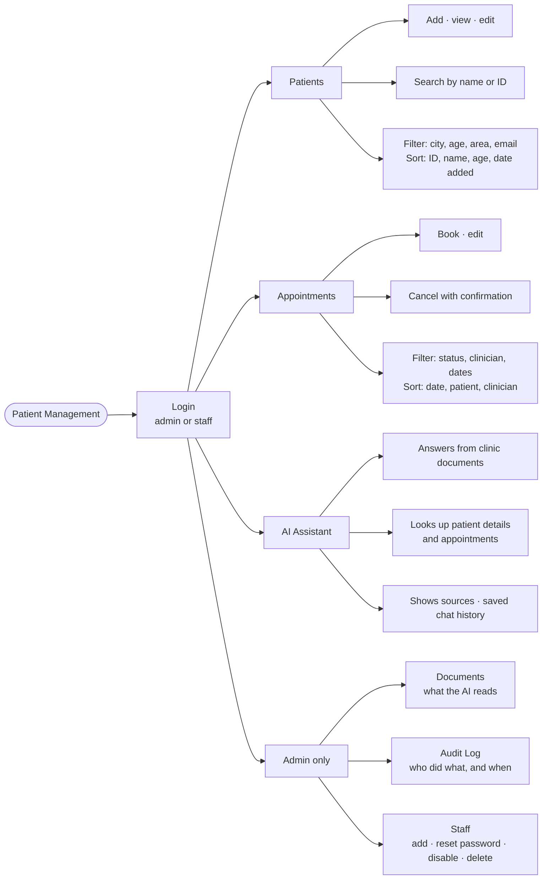
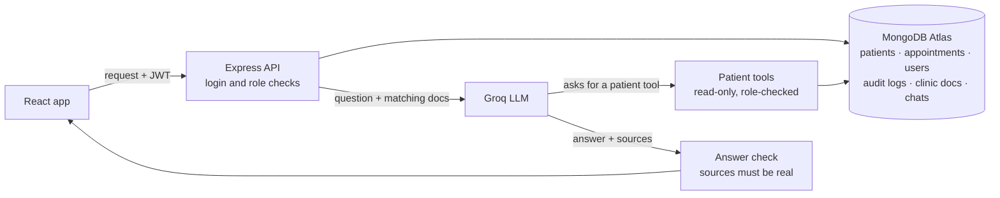

# Patient Management System

A clinic staff portal for managing patients and appointments, with an AI assistant that answers from clinic documents and patient records.

All data is fictional. The app gives no diagnosis or treatment advice.

**Stack:** React (Vite) + Ant Design · Node.js + Express · MongoDB Atlas + Mongoose · Groq (`openai/gpt-oss-20b`) · JWT + bcrypt · Jest

---

## Features



---

## Architecture



How the AI answers a question:

```
question ──► safety check ──► search clinic docs ──► LLM
                                                      │
                     patient question? ◄──────────────┤
                            │                         │
            get_patient_details / get_patient_appointments
                            │                         │
                            └────────► LLM writes answer
                                              │
                         sources real + second AI check passes?
                              │yes                    │no
                     answer + sources     "I don't have enough information"
```

---

## Project structure

```
Patient_Management/
├── backend/
│   ├── routes/        API endpoints
│   ├── services/      business logic (patients, appointments, staff, chat, LLM)
│   ├── tools/         the AI's patient tools
│   ├── models/        database schemas
│   ├── middleware/    login and role checks, error handling
│   ├── docs/          clinic documents the AI answers from
│   ├── setup/         migrations and seed data
│   └── tests/         Jest tests
├── frontend/src/
│   ├── pages/         Patients, Appointments, AI Assistant, Documents, Audit Log, Staff
│   ├── components/    layout, forms, tables
│   └── api/           backend client
└── .env.example
```

Key files: [`app.js`](backend/app.js) · [`chatService.js`](backend/services/chatService.js) · [`patientTools.js`](backend/tools/patientTools.js) · [`llmService.js`](backend/services/llmService.js) · [`auth.js`](backend/middleware/auth.js)

---

## Setup and run

Needs Node.js 18+, a MongoDB database ([Atlas free tier](https://cloud.mongodb.com) works) and a [Groq API key](https://console.groq.com/keys).

**1. Environment variables**

```bash
cp .env.example backend/.env                     # then fill in the values
cp frontend/.env.example frontend/.env           # optional, only for a hosted backend
```

| Variable | Value |
|---|---|
| `MONGO_URI` | MongoDB connection string with the database name |
| `MONGO_URI_TEST` | A separate database for tests |
| `JWT_SECRET` | Any long random string (`openssl rand -hex 32`) |
| `GROQ_API_KEY` | Your Groq key |
| `GROQ_MODEL` | `openai/gpt-oss-20b` |
| `PORT` · `CLIENT_ORIGIN` | `5050` · `http://localhost:5173` |

**2. Database** (see [Database](#database))

```bash
cd backend && npm install && npm run setup
```

**3. Run**

```bash
cd backend && npm run dev        # API on http://localhost:5050
cd frontend && npm install && npm run dev   # app on http://localhost:5173
```

**Logins**

| Username | Password | Role |
|---|---|---|
| `admin` | `Admin@123` | admin |
| `staff` | `Staff@123` | staff |

---

## Database

```bash
npm run migrate   # create collections, validation rules and indexes
npm run seed      # load the demo data (wipes existing data)
npm run setup     # both
```

| Collection | Fields |
|---|---|
| `users` | username, passwordHash, role, active, lastLoginAt |
| `patients` | patientId (P-0001), name, dateOfBirth, phone, email, address |
| `appointments` | patient, dateTime, clinician, reason, status (scheduled / completed / cancelled) |
| `audit_logs` | username, action, patientId or targetUsername, createdAt |
| `faq_sections` | source, section, text (text index) |
| `conversations` | user, title, messages |

- **Migrations:** [`backend/setup/migrations/`](backend/setup/migrations/)
- **Seed data:** [`backend/setup/seed-data/`](backend/setup/seed-data/) (2 users, 150 patients across Hyderabad and Bangalore, 198 appointments)
- **Clinic documents:** [`backend/docs/`](backend/docs/) (opening hours, cancellation, billing, insurance, contact)
- Full guide with `mongosh` checks: [`backend/setup/README.md`](backend/setup/README.md)

---

## Tests

```bash
cd backend
npm test        # 49 tests: login, patients, appointments, staff, AI tools, chat guardrails
npm run eval    # 12 questions against the real model, checking answers and sources
```

Tests use `MONGO_URI_TEST` and a mocked LLM, so they never call Groq.

---

## Known limitations

- Keyword search only, so it misses synonyms ("fees" vs "billing")
- Answers aren't streamed
- Every staff member can see every patient
- The login token is kept in the browser, with no refresh tokens
- Groq's free tier limits how many questions per minute the AI can answer
