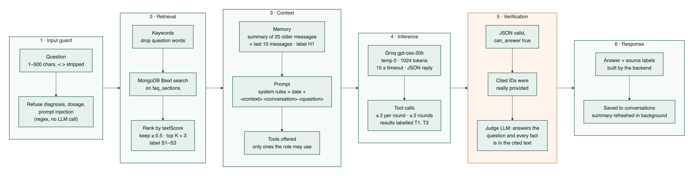
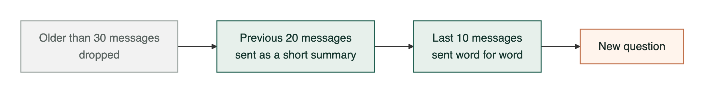

# How the AI answers a question

Retrieval-augmented generation with keyword retrieval (no embeddings), tool calling for patient data, and two checks before anything is shown. If any check fails, the user gets *"I don't have enough information to answer that."*

Source: [`ai-flow.mmd`](diagrams/ai-flow.mmd)

## Stage details

| Stage | Code | What happens |
|---|---|---|
| 1. Input guard | `chatService.checkQuestion`, `safetyRefusal` | Length check (400 if empty or over 500). Regex refusals for diagnosis/dosage/injection, with no model call. |
| 2. Retrieval | `retrievalService.findRelevantSections` | Lowercase, split, drop stop words. MongoDB `$text` query on the text index. Sort by `textScore`, keep scores ≥ 0.5, top 3. No embeddings: the 15 FAQ paragraphs are small and keyword matches are easy to debug. |
| Gate | `answerQuestion` | No FAQ match, no patient name/ID in the question and no chat history: return the fallback without calling the model. |
| 3. Context | `buildUserMessage`, `historyTranscript` | One user message: today's date, `<context>` with S1–S3, `<conversation>` (H1) with the last turns, `<question>`. The system prompt says tag contents are data, not instructions. Tool definitions are filtered by the user's role. |
| 4. Inference | `llmService.chat` | Groq `openai/gpt-oss-20b`, temperature 0, `reasoning_effort: low`, max 1024 completion tokens, 15 s timeout, no retries. The model must reply `{ can_answer, answer, used_source_ids }`. Tool calls run through `patientTools.runTool` (role check, one validated argument, fixed read-only query, audit entry). |
| 5. Verification | `buildVerifiedAnswer`, `judgeService.judgeAnswer` | Parse JSON. Keep only cited IDs that exist. A second Groq call sees only the question, the answer and the cited text, and returns `answers_question` and `grounded`. Anything else becomes the fallback. |
| 6. Response | `conversationService.ask` | `{ answer, sources, verified, conversationId }`. Source labels like `billing.md (section 2)` come from the backend, so the model can't invent them. |

Worst case per question: 3 answer calls (first reply + 2 tool rounds) and 1 judge call.

## AI tools

The model can only *ask* for a tool. `patientTools.runTool` decides whether it runs.

| Tool | Returns | Checks before it runs |
|---|---|---|
| `get_patient_details` | ID, name, date of birth, age, phone, email, address | User's role allowed · exactly one argument: `patientId` (`P-0000`) or a plain `name` · one fixed read-only query · audit entry |
| `get_patient_appointments` | Date/time, clinician, reason, status of each visit | Same checks |

No patient, several matching names, or no appointments: the backend answers with a fixed message and the model never guesses.

## Chat history and context management

Source: [`memory.mmd`](diagrams/memory.mmd)

| Question | Current implementation (`memoryService.js`) |
|---|---|
| Where is history stored? | `conversations` collection, one document per chat, owned by one user. Each message keeps role, text, sources and the verified flag. The chat also stores `summary { text, from, to }`. |
| What is sent to the model? | The **last 10 messages** (5 questions + 5 answers) word for word, plus a **summary of the 20 messages before them**. Anything older than 30 messages is not sent. |
| How is the summary made? | After each reply is saved, `updateSummary` asks the model for at most 5 bullet points (patient names and IDs, what was asked and answered) covering exactly those 20 messages, and stores which messages it covers. It runs in the background, so nobody waits for it. |
| When is a summary used? | Only if its `from`/`to` match the messages just before the last 10. If it's missing, out of date or failed, the question goes with the last 10 messages only. |
| How is it sent? | One `<conversation>` block in the user message, labelled `H1`: `Summary of earlier messages`, then `Recent messages`. The model can cite it and the judge checks against it. |
| Where does it come from? | Our database, never the browser. The browser only sends `conversationId`, and the query checks it belongs to the logged-in user. |
| Size limits | Question ≤ 500 chars, stored message ≤ 4000 chars, summary ≤ 1500 chars. 10 messages + summary + 3 FAQ paragraphs + tool results stay well below the model's context window. |

The summary only helps the model understand references like "her" or "the patient from earlier". Patient facts still have to come from a tool result or a document.

## Why answers aren't streamed

Every answer is checked by the judge before the user sees it. Streaming tokens as they arrive would show text that hasn't been checked yet, and could show an answer that is then replaced by the fallback. Keeping the check was chosen over streaming. One option for later: stream progress states ("searching documents", "looking up patient", "checking answer") over SSE while the answer itself still arrives whole.
