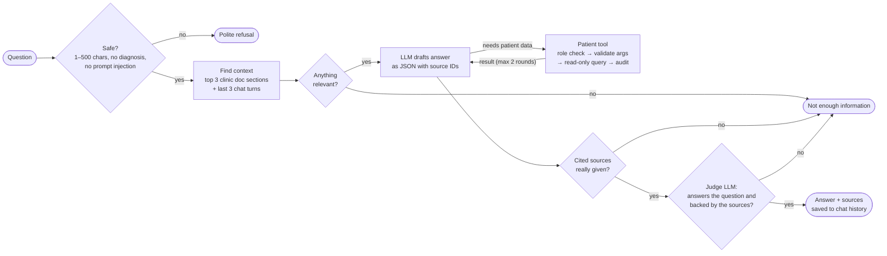

# How the AI answers a question

The model only answers from what the backend gives it, and the backend checks the answer before it is shown. Anything that fails a check becomes *"I don't have enough information to answer that."*

| Source ID | What it is |
|---|---|
| `S1`–`S3` | Clinic document sections found by keyword search |
| `T1`, `T2` | Results from `get_patient_details` / `get_patient_appointments` |
| `H1` | Earlier turns of this chat |
