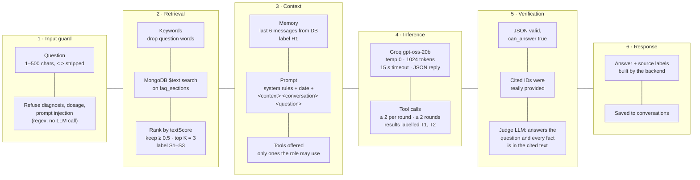

# How the AI answers a question

Retrieval-augmented generation with keyword retrieval (no embeddings), tool calling for patient data, and two checks before anything is shown. If any check fails, the user gets *"I don't have enough information to answer that."*

## Stage details

| Stage | Code | What happens |
|---|---|---|
| 1. Input guard | `chatService.checkQuestion`, `safetyRefusal` | Length check (400 if empty or over 500). Regex refusals for diagnosis/dosage/injection, with no model call. |
| 2. Retrieval | `retrievalService.findRelevantSections` | Lowercase, split, drop stop words. MongoDB `$text` query on the text index. Sort by `textScore`, keep scores ≥ 0.5, top 3. No embeddings: the 15 FAQ paragraphs are small and keyword matches are easy to debug. |
| Gate | `answerQuestion` | No FAQ match, no patient name/ID in the question and no chat history: return the fallback without calling the model. |
| 3. Context | `buildUserMessage`, `historyTranscript` | One user message: today's date, `<context>` with S1–S3, `<conversation>` (H1) with the last turns, `<question>`. The system prompt says tag contents are data, not instructions. Tool definitions are filtered by the user's role. |
| 4. Inference | `llmService.chat` | Groq `openai/gpt-oss-20b`, temperature 0, `reasoning_effort: low`, max 1024 completion tokens, 15 s timeout, no retries. The model must reply `{ can_answer, answer, used_source_ids }`. Tool calls run through `patientTools.runTool` (role check, one validated argument, fixed read-only query, audit entry). |
| 5. Verification | `buildVerifiedAnswer`, `judgeService.judgeAnswer` | Parse JSON. Keep only cited IDs that exist. A second Groq call sees only the question, the answer and the cited text, and returns `answers_question` and `grounded`. Anything else becomes the fallback. |
| 6. Response | `conversationService.ask` | `{ answer, sources, verified, conversationId }`. Source labels like `billing.md (section 2)` come from the backend, so the model can't invent them. |

Worst case per question: 3 answer calls (first reply + 2 tool rounds) and 1 judge call.

## Chat history and context management

| Question | Current implementation |
|---|---|
| Where is history stored? | `conversations` collection, one document per chat, owned by one user. Each message keeps role, text, sources and the verified flag. |
| What is sent to the model? | A sliding window: the **last 6 messages** (3 questions + 3 answers) of the current chat (`HISTORY_MESSAGES` in `conversationService.js`). Older turns are not sent. |
| How is it sent? | As a plain transcript inside one `<conversation>` block in the user message, labelled `H1`, so the model can cite it like any other source and the judge can check it. It is not sent as separate chat-role messages. |
| Where does it come from? | Our database, never the browser. The browser only sends `conversationId`, and the query checks it belongs to the logged-in user. |
| Summaries / RAG memory? | Not used. No summarising, no rolling summaries, no retrieval over old messages. |
| Size limits | Question ≤ 500 chars, stored message ≤ 4000 chars. 6 messages + 3 FAQ paragraphs + tool results stay far below the model's context window. |

**For long conversations (not built yet):** keep the 6-message window, and once a chat passes about 10 turns, ask the model for a short rolling summary of the older turns (who the patient is, what was asked) and store it on the conversation. Send summary + last 6 messages. Facts would still have to come from tools or documents, because the summary is only used to resolve references like "her" or "that patient".

## Why answers aren't streamed

Every answer is checked by the judge before the user sees it. Streaming tokens as they arrive would show text that hasn't been checked yet, and could show an answer that is then replaced by the fallback. Keeping the check was chosen over streaming. One option for later: stream progress states ("searching documents", "looking up patient", "checking answer") over SSE while the answer itself still arrives whole.
