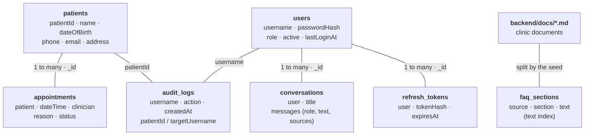

# Database

MongoDB Atlas, seven collections. The top row holds the main records; each one below links back to them.

| Collection | Holds |
|---|---|
| `users` | Admin and staff logins (passwords stored as bcrypt hashes) |
| `patients` | Fictional patient records, IDs like `P-0001` |
| `appointments` | Bookings linked to a patient, status scheduled / completed / cancelled |
| `audit_logs` | Who viewed or changed which patient or staff account, and when |
| `conversations` | Saved AI chats, each owned by one user |
| `refresh_tokens` | One row per login session, deleted automatically when it expires |
| `faq_sections` | Clinic documents split into paragraphs, with a text index for search |

**Indexes:** `patients.patientId` (unique) · `patients.name` · `users.username` (unique) · `appointments.patient + dateTime` · `audit_logs.createdAt` · `conversations.user + updatedAt` · `refresh_tokens.tokenHash` (unique) + TTL on `expiresAt` · text index on `faq_sections.text`.

Migrations: [`backend/setup/migrations/`](../backend/setup/migrations/) · Seed data: [`backend/setup/seed-data/`](../backend/setup/seed-data/)
