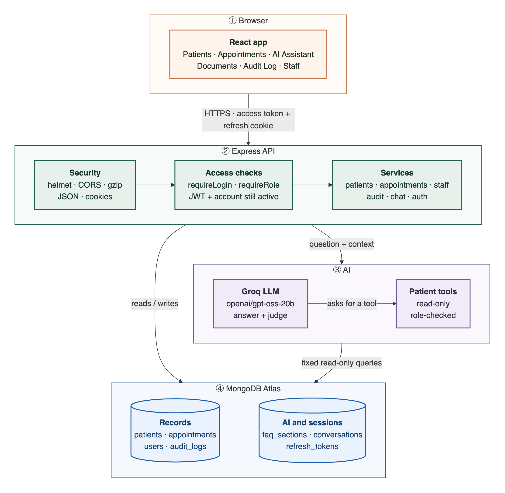

# System architecture

The browser only talks to the Express API. The API checks who you are and what you may do, then reads and writes MongoDB or calls Groq. The Groq key never leaves the server.

Source: [`system.mmd`](diagrams/system.mmd)

| Piece | Where |
|---|---|
| Access token | JWT, 15 minutes, sent as `Authorization: Bearer` |
| Refresh token | Random 96-char token, 7 days, httpOnly cookie on `/api/auth`, stored hashed, replaced on every use |
| API docs | Swagger at `/api/docs` · table in [API.md](../API.md) |
